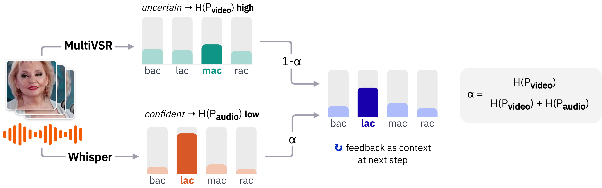

# Audio-Visual Speech Recognition (AVSR)

This folder contains the AVSR experiments reported in the paper:
**decoding-time fusion of our VSR model (video) with a fine-tuned Whisper
model (audio), under noisy conditions.**

The VSR model uses the [MultiVSR](https://github.com/Sindhu-Hegde/multivsr)
architecture (Prajwal et al., 2025), trained on our VSRo-200 dataset.

The motivation: visual speech recognition is unaffected by acoustic
noise. At low SNRs, fusing video predictions with audio predictions
substantially improves over audio-only (Whisper) decoding.

## Architecture



At each decoding step, both branches produce a probability distribution over
the next token. The weight of the audio branch is computed from the Shannon
entropy of the two distributions:

$$\alpha = \frac{H(P_{\text{video}})}{H(P_{\text{audio}}) + H(P_{\text{video}})}$$

and the fused distribution is

$$P_{\text{fused}} = \alpha \, P_{\text{audio}} + (1 - \alpha) \, P_{\text{video}}$$

The branch that is less certain at that step counts for less. As noise
increases, Whisper's distribution flattens, its entropy rises, $\alpha$ falls,
and the video branch carries more of the decision. $\alpha$ is recomputed for
every token and every beam. Beam search then runs on $\log P_{\text{fused}}$.

The audio-only and video-only baselines use the same beam search, so the
difference between the three modes comes from the information available,
not from the decoder.

## Quick start

From the repository root, after running the main `bash scripts/setup.sh`:

```bash
cd evaluation/avsr
python inference_avsr.py --fpath samples_avsr/sample_1_babble_SNR-5.avi --mode all
```

## Decoding modes

The `--mode` flag selects how predictions are produced:

- **`fusion`** (default): entropy-weighted fusion of both branches.
- **`audio`**: audio-only baseline (Whisper alone).
- **`video`**: video-only baseline (our VSR model alone).
- **`all`**: the three above on the same clip, with the models loaded once.

In fusion mode the script also prints the mean $\alpha$ over the decoding
steps, i.e. the average share of the audio branch.

## Demo samples

We provide 6 samples built from 3 clips of the unseen-speaker test split,
each clip once with babble and once with Gaussian noise mixed into the audio
track. The video is the clean face crop; only the audio is
degraded. The noise is the exact realisation used in the paper's evaluation
(Gaussian noise seeded per clip; babble from 4 [MUSAN](https://www.openslr.org/17/)
speakers selected per clip), and the audio is stored as uncompressed float
PCM so that it is not altered by encoding. Decoding these clips therefore
reproduces the per-clip results of the paper.

| File | Noise | SNR | WER audio | WER video | WER fusion |
| --- | --- | --- | --- | --- | --- |
| `sample_1_babble_SNR-5.avi` | babble (4 speakers) | −5 dB | 89.47% | 47.37% | 31.58% |
| `sample_2_gaussian_SNR-5.avi` | Gaussian (white) | −5 dB | 78.95% | 47.37% | 36.84% |
| `sample_3_babble_SNR-5.avi` | babble (4 speakers) | −5 dB | 84.21% | 63.16% | 36.84% |
| `sample_4_gaussian_SNR0.avi` | Gaussian (white) | 0 dB | 47.37% | 63.16% | 36.84% |
| `sample_5_babble_SNR5.avi` | babble (4 speakers) | 5 dB | 46.67% | 86.67% | 20.00% |
| `sample_6_gaussian_SNR10.avi` | Gaussian (white) | 10 dB | 60.00% | 86.67% | 26.67% |

Samples 1 and 2, 3 and 4, 5 and 6 share a clip, so the video-only result is
the same within each pair. Fusion improves over both single-modality branches
on all six, including samples 5 and 6, where the video branch alone is weak.

Reference transcriptions, the source of each clip in the public dataset, the
noise seed and the MUSAN files used for babble are listed in
[`samples_avsr/samples_avsr_metadata.csv`](samples_avsr/samples_avsr_metadata.csv).

## CLI options

```
--fpath          Path to input video (.avi or .mp4 with audio track)
--vsr_model      Checkpoint filename in vsro200/models-vsro200 (default: model_200h_auto.pt)
--whisper_model  HF repo for Whisper (default: vsro200/whisper-small-vsro200)
--mode           fusion | audio | video | all (default: fusion)
--beam_size      Beam size (default: 5)
--max_len        Max output tokens (default: 256)
--metadata       Metadata CSV for WER lookup (default: samples_avsr/samples_avsr_metadata.csv)
--device         cuda | cpu (default: auto-detect)
```

## Citation

If you use the AVSR setup, please cite our paper as well as the underlying
audio model and Whisper itself:

```bibtex
@misc{diaconu2026ron3ws,
  title  = {RO-N3WS: Enhancing Generalization in Low-Resource ASR with
            Diverse Romanian Speech Benchmarks},
  author = {Diaconu, Alexandra and Vînagă, Mădălina and Alexe, Bogdan},
  year   = {2026},
  url    = {https://arxiv.org/abs/2603.02368},
}
```
